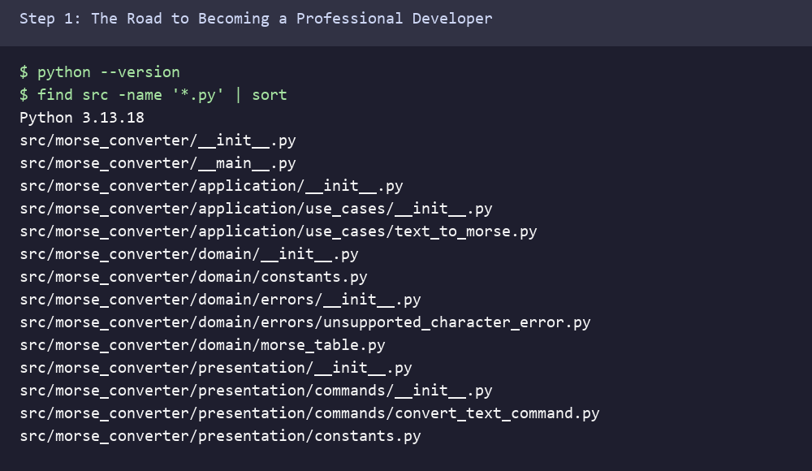
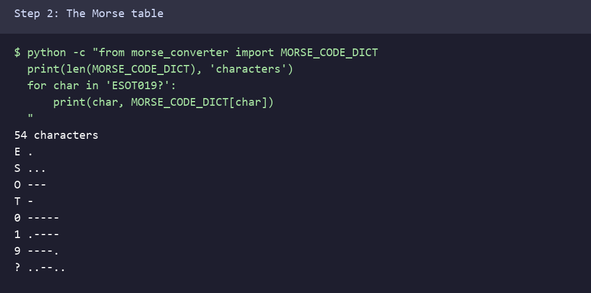
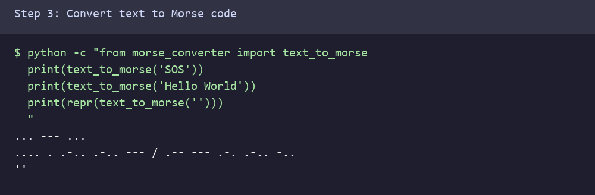
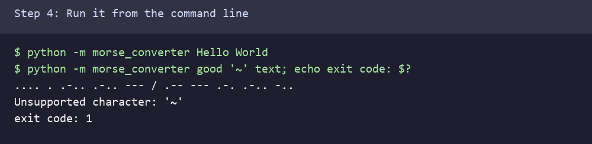

# 🚀 082 Text to Morse Code Converter

Day 82 of Udemy's *100 Days of Code: The Complete Python Pro Bootcamp*: a text-based Python program that converts a string into Morse code. It is for course participants who want runnable, tested code with the assignment's function name, and for anyone who browses the repository for ideas.

## 📚 Table of Contents

- [Overview](#-overview)
- [Requirements](#-requirements)
- [Setup](#-setup)
- [Run](#-run)
- [The four steps](#-the-four-steps)
- [Tests](#-tests)
- [License](#-license)
- [Links](#-links)
- [Appendix: Project documents](#-appendix-project-documents)

## 🧭 Overview

The assignment is one sentence: a text-based Python program that converts strings into Morse code. This repository solves it as a small project: a use case and its design come first, the code follows the design, and a wiki in English, Danish and Bahasa Malaysia explains what each step teaches.

| Folder | What it holds |
| --- | --- |
| `src/morse_converter/` | The converter: `text_to_morse` and the command line, in the layers `domain`, `application` and `presentation` of the design |
| `tests/` | Tests that follow the use case and the operation contract |
| `notebooks/` | The Jupyter notebook that walks through the steps |
| `docs/` | Project documents, the use case and its design (`docs/use-cases/uc-001/`, `docs/dcd.md`), screenshots (`docs/images/`) and the wiki sources (`docs/wiki/`: English, Danish, Bahasa Malaysia) |
| `scripts/` | `scan.sh` (opengrep) and `make_screenshots.py` |
| `framework/` | The SQA and QC framework (a git submodule) that the project documents follow |
| `Doxyfile` | The Doxygen configuration; the source uses Doxygen comments |
| `.editorconfig` | The editor settings of the framework baseline |
| `.env.example` | Placeholders for the git host tokens that the framework scripts read; the program itself reads no setting from `.env` |

The project is built in gateways (see the [Project Plan][PP-001]), one branch and one pull request for each, so the history shows the steps.

## 📋 Requirements

- Python 3.13 or newer, to run the code.
- No runtime dependency: the converter uses the standard library only.
- `pytest`, `ruff`, `mypy`, Jupyter and Pillow, only for development; they are installed with the `dev` extra.
- Doxygen, only to build the source documentation.
- Docker, only to regenerate the screenshots in a container.

## 🛠️ Setup

Create and use a local virtual environment named `.venv`, then bring `pip` up to date and install the project.

Windows (PowerShell):

```powershell
python -m venv .venv
.venv\Scripts\Activate.ps1
python -m pip install --upgrade pip
python -m pip install -e ".[dev]"
```

Linux and macOS:

```bash
python3 -m venv .venv
source .venv/bin/activate
python -m pip install --upgrade pip
python -m pip install -e ".[dev]"
```

Leave out `[dev]` if you only want to run the converter. `deactivate` leaves the environment.

## ▶️ Run

Give the text as arguments or type it at the prompt:

```bash
python -m morse_converter Hello World
python -m morse_converter
```

The first command prints `.... . .-.. .-.. --- / .-- --- .-. .-.. -..`. Words are separated by ` / ` and the letters of a word by one space. A character that has no Morse code (for example `~`) is named on the error stream, nothing is converted and the exit code is 1.

From Python, use the names of the assignment:

```python
from morse_converter import MORSE_CODE_DICT, text_to_morse

text_to_morse("SOS")  # '... --- ...'
```

The notebook `notebooks/Text_to_Morse_Code_Converter.ipynb` runs the same steps; start it with `python -m jupyter lab`.

## 🪜 The four steps

The lecture (Day 82, "The Road to Becoming a Professional Developer") is summarised in words only: build a project without a guide, break it into small steps, look things up when you are stuck, and keep going. The repository follows four steps; the screenshots show the program's own output, made by `scripts/make_screenshots.py` in a Docker container (Linux, Python 3.13). The wiki explains what each step teaches, in English, Danish and Bahasa Malaysia.

1. **The Road to Becoming a Professional Developer**: a use case and its design first, then a project with its own `.venv`, tests and layers.

   

2. **The Morse table**: a dictionary of 54 characters in `constants.py`.

   

3. **Convert text to Morse code**: `text_to_morse` splits the text into words and joins the codes.

   

4. **Run it from the command line**: `python -m morse_converter`, with the exit code 0 or 1.

   

To make the screenshots again (Docker must be running):

```bash
python scripts/make_screenshots.py
```

## 🧪 Tests

```bash
python -m pytest
```

The tests include the notebook, which runs headlessly, and the command line, which runs as a subprocess. For the static checks:

```bash
python -m ruff check src tests scripts
python -m ruff format --check src tests scripts
python -m mypy
```

Before pushing, scan the files with opengrep (default path `~/.opengrep/cli/latest/opengrep.exe`; `git add` new files first, because opengrep scans tracked files):

```bash
bash scripts/scan.sh
```

The pull request check also runs the rules of `github.com/opengrep/opengrep-rules`; to run them locally, clone that repository and set `OPENGREP_RULES` to the folder before the scan.

Build the source documentation with Doxygen (the output goes to `docs/doxygen/`, which git ignores):

```bash
doxygen Doxyfile
```

## 📄 License

GNU Affero General Public License v3.0 only (AGPL-3.0-only), see [LICENSE][license].

## 🔗 Links

- [Repository][repository]
- [Documentation][documentation]
- [Issue tracker][issues]

## 📎 Appendix: Project documents

The documents a newcomer needs, in reading order.

| Document | What it tells you |
| --- | --- |
| [Business Case][BC-001] | Why the project exists, its scope and success criteria |
| [Stakeholder Analysis][SA-001] | Who is involved; the stakeholder IDs used for owners and reviewers |
| [Project Plan][PP-001] | The gateways and their schedule |
| [Milestones][milestones] | One document per gateway: Go/No-Go criteria and tasks |
| [Use case][UC-001] | What the converter does for its user |
| [Design Class Diagram][DCD-001] | The classes and methods the code follows |
| [Artifact registry][registry] | Where each artifact type lives, the next version, the PO language and domain |
| [Domain dictionary][DICT-001] | The PO terms and the IT terms |
| [Traceability matrix][TM-001] | How the artifacts link and when each was last reviewed |
| [Framework README][framework-readme] | The framework this project uses |
| [Framework changelog][framework-changelog] | What changed in each framework release |

---

[repository]: https://git.tirsystem.com/Tirsvad-Udemy-100-days-of-code/082-assignment-text-to-morse-code-converter
[documentation]: https://git.tirsystem.com/Tirsvad-Udemy-100-days-of-code/082-assignment-text-to-morse-code-converter/wiki
[issues]: https://git.tirsystem.com/Tirsvad-Udemy-100-days-of-code/082-assignment-text-to-morse-code-converter/issues
[license]: ./LICENSE
[BC-001]: ./docs/business-case.md
[SA-001]: ./docs/stakeholder-analysis.md
[PP-001]: ./docs/project-plan.md
[milestones]: ./docs/milestones/
[UC-001]: ./docs/use-cases/uc-001/uc.md
[DCD-001]: ./docs/dcd.md
[registry]: ./docs/artifact-registry.md
[DICT-001]: ./docs/dictionary.md
[TM-001]: ./docs/sqa/traceability-matrix.md
[framework-readme]: ./framework/README.md
[framework-changelog]: ./framework/CHANGELOG.md
