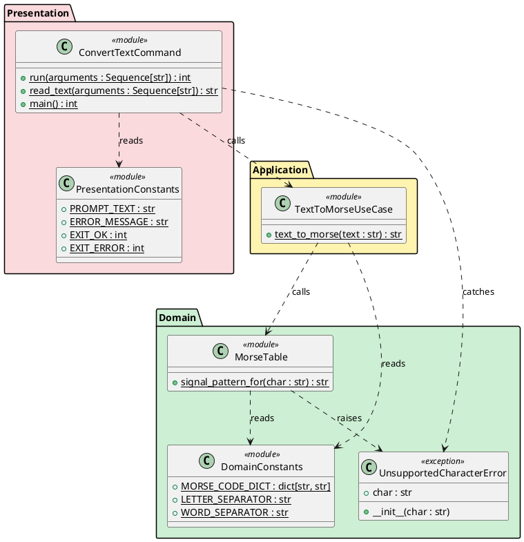

# Design Class Diagram

## Metadata
| Key | Value |
| --- | --- |
| ID | DCD-001 |
| CrossReference | [DM-001], [SD-001], [DICT-001] |

## Version History
| Date | Status | Author | Reviewer | Change | Commit |
| --- | --- | --- | --- | --- | --- |
| 2026-11-19 | Accepted | Jens Tirsvad Nielsen | S01 | Initial version Reviewed in RC-017: Go | [ba98d67] |

---

## Purpose and Scope

Defines the classes and methods that realise [SD-001] (the sequence of `convertTextToMorse`). It answers the concerns CN-001, CN-003 and CN-004 of [SA-001] (a correct converter that S02 can run and that has the assignment's function name) and serves the developers: S01 and, as readers, S02. Python has no static class, so a design class marked `<<module>>` is implemented as a Python module of functions and constants; a class marked `<<exception>>` is a Python class. The package is `morse_converter`.

## Diagram

No class is an association partner of another: the design classes hold no references to each other, so the diagram has dependencies only. The package dependencies are Presentation → Application, Presentation → Domain and Application → Domain, all pointing inward. `UnsupportedCharacterError` extends the built-in `ValueError`.

## Class Table

| Class | Refines (Domain Model concept) | Responsibility | Attributes | Operations |
| --- | --- | --- | --- | --- |
| `ConvertTextCommand` | none: a technical class (the command line) | Gets the `text` from the arguments or a prompt, calls the use case and shows the `morse` or the error | none | `run`, `read_text`, `main` |
| `PresentationConstants` | none: a technical class (command-line texts and exit codes) | Holds the constants of the command line | `PROMPT_TEXT`, `ERROR_MESSAGE`, `EXIT_OK`, `EXIT_ERROR` | none |
| `TextToMorseUseCase` | Morse Code, Text, Word | Builds the `morse` of a `text`: splits it into `words`, gets the `code` of each `char` and joins them | none | `text_to_morse` |
| `MorseTable` | Signal Pattern, Character | Returns the `code` that represents a `char` and rejects a `char` that has none | none | `signal_pattern_for` |
| `DomainConstants` | Signal Pattern | Holds the Morse table and the two separators | `MORSE_CODE_DICT`, `LETTER_SEPARATOR`, `WORD_SEPARATOR` | none |
| `UnsupportedCharacterError` | Character | Tells that a `char` has no `code` and which `char` it is | `char` | `__init__` |

SOLID: each class has one responsibility; the use case depends on the Domain only (dependency inversion needs no port because the program has no outside system to reach); no class is a god class.

## Method Traceability

| Method signature | Operation Contract / SD message |
| --- | --- |
| `ConvertTextCommand.run(arguments: Sequence[str]) -> int` | `run(arguments)` in [SD-001], the entry of `convertTextToMorse` in [OC-001] |
| `ConvertTextCommand.read_text(arguments: Sequence[str]) -> str` | `read_text(arguments)` in [SD-001] |
| `ConvertTextCommand.main() -> int` | `run(arguments)` in [SD-001]: the entry point that passes the program arguments to `run` |
| `TextToMorseUseCase.text_to_morse(text: str) -> str` | `text_to_morse(text)` in [SD-001]; the postconditions of [OC-001] |
| `MorseTable.signal_pattern_for(char: str) -> str` | `signal_pattern_for(char)` in [SD-001] |
| `UnsupportedCharacterError.__init__(char: str)` | `create(char)` in [SD-001], the exception of [OC-001] |

The package `morse_converter` also exports `text_to_morse` and `MORSE_CODE_DICT` from its `__init__` module so that S02 can import the assignment's names; that export adds no method.

## Pattern Annotations

| Pattern | Classes | Rationale |
| --- | --- | --- |
| Controller (GRASP) | `ConvertTextCommand` | Receives the system operation; the layout "one command per use case" of `clean-architecture` |
| Information Expert (GRASP) | `MorseTable`, `DomainConstants` | The table and the lookup are together in the Domain |
| Protected Variations (GRASP) | `UnsupportedCharacterError` | One specific error protects callers from the lookup detail |

## Dependency Check

No circular dependency: Presentation → Application → Domain and Presentation → Domain; no Domain class depends on an outer layer, and every dependency points inward. The program has no Infrastructure package: the standard streams used by `ConvertTextCommand` are those of the Python runtime and are not a class of the design.

---

[DM-001]: ./domain-model.md
[SD-001]: ./use-cases/uc-001/sd.md
[OC-001]: ./use-cases/uc-001/oc.md
[DICT-001]: ./dictionary.md
[SA-001]: ./stakeholder-analysis.md
[ba98d67]: https://git.tirsystem.com/Tirsvad-Udemy-100-days-of-code/082-assignment-text-to-morse-code-converter/commit/ba98d6725280ec49e8e215622959ea535d58843c
