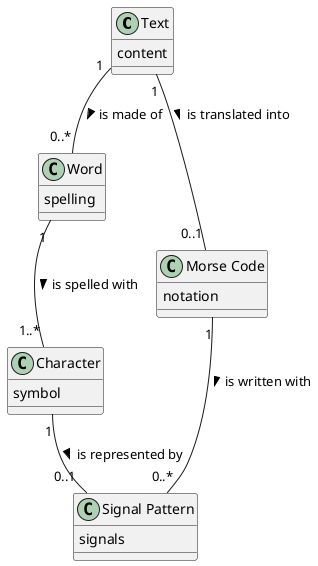

# Domain Model

## Metadata
| Key | Value |
| --- | --- |
| ID | DM-001 |
| CrossReference | [UC-001], [UCD-001], [SSD-001], [DICT-001] |
| Language | en |
| Domain | it |

## Version History
| Date | Status | Author | Reviewer | Change | Commit |
| --- | --- | --- | --- | --- | --- |
| 2026-11-19 | Accepted | Jens Tirsvad Nielsen | S01 | Initial version Reviewed in RC-012: Go | pending |

---

## Purpose and Scope

Covers [UC-001] Convert Text to Morse Code. It answers the concern CN-001 of [SA-001] (the Morse code is correct) and serves S01, the Product Owner, and the domain experts: what a text and its Morse code are made of.

## Diagram

Concepts, attributes and associations only — no operations.

## Concept Table

| Concept | Definition | Attributes | Source (use case / glossary) |
| --- | --- | --- | --- |
| Text | The words a Converter User wants to send | content | "Text" in [UC-001], step 1 |
| Word | A group of Characters between two spaces of a Text | spelling | "Word" in [UC-001], step 3 |
| Character | One letter, digit or punctuation mark of a Word | symbol | "Character" in [UC-001], step 2 |
| Signal Pattern | The dots and dashes that stand for one Character | signals | "Signal Pattern" in [UC-001], step 2 |
| Morse Code | The Text written as Signal Patterns | notation | "Morse Code" in [UC-001], step 3 |

## Association Table

| From | Association (reading direction) | To | Multiplicity |
| --- | --- | --- | --- |
| Text | is made of | Word | 1 to 0..* |
| Word | is spelled with | Character | 1 to 1..* |
| Character | is represented by | Signal Pattern | 1 to 0..1 (0 when the Character is not supported) |
| Morse Code | is written with | Signal Pattern | 1 to 0..* |
| Text | is translated into | Morse Code | 1 to 0..1 (0 when the Text is rejected) |

## Generalizations

None.

---

[UC-001]: ./use-cases/uc-001/uc.md
[UCD-001]: ./use-case-diagram.md
[SSD-001]: ./use-cases/uc-001/ssd.md
[DICT-001]: ./dictionary.md
[SA-001]: ./stakeholder-analysis.md
