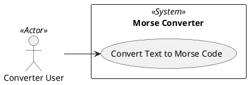

# Use Case Diagram

## Metadata
| Key | Value |
| --- | --- |
| ID | UCD-001 |
| CrossReference | [SA-001], [BC-001], [US-001], [UC-001] |
| Language | en |
| Domain | it |

## Version History
| Date | Status | Author | Reviewer | Change | Commit |
| --- | --- | --- | --- | --- | --- |
| 2026-11-19 | Accepted | Jens Tirsvad Nielsen | S01 | Initial version Reviewed in RC-010: Go | pending |

---

## Purpose and Scope

The system boundary is the Morse converter program: the part of the repository that turns a text into Morse code. The Converter User gives the system a text and receives the Morse code. The notebook, the wiki and the screenshots are documentation, not part of the system boundary.

## Diagram

Crossings of the chosen layout: 0 (one actor, one use case, one association).

## Actor Table

| Actor | Stereotype | Stakeholder ID (SA) | Goals (use cases) |
| --- | --- | --- | --- |
| Converter User | `<<Actor>>` | S01, S02 | Convert Text to Morse Code |

S03 browses the repository and does not run the system, so it is not an actor.

## Use Case Table

| Use Case | Actor(s) | Goal | Source story | Priority (MoSCoW) | Reason |
| --- | --- | --- | --- | --- | --- |
| [UC-001] Convert Text to Morse Code | Converter User | Get the Morse code of a text | [US-001] | Must | It is the whole assignment ([BC-001] objective 1) |

## Role Matrix

There is one primary actor (Converter User), so no role matrix is needed.

## Relationships

There is no `<<include>>` or `<<extend>>` relationship: the system has one use case.

---

[SA-001]: ./stakeholder-analysis.md
[BC-001]: ./business-case.md
[US-001]: ./user-stories.md
[UC-001]: ./use-cases/uc-001/uc.md
