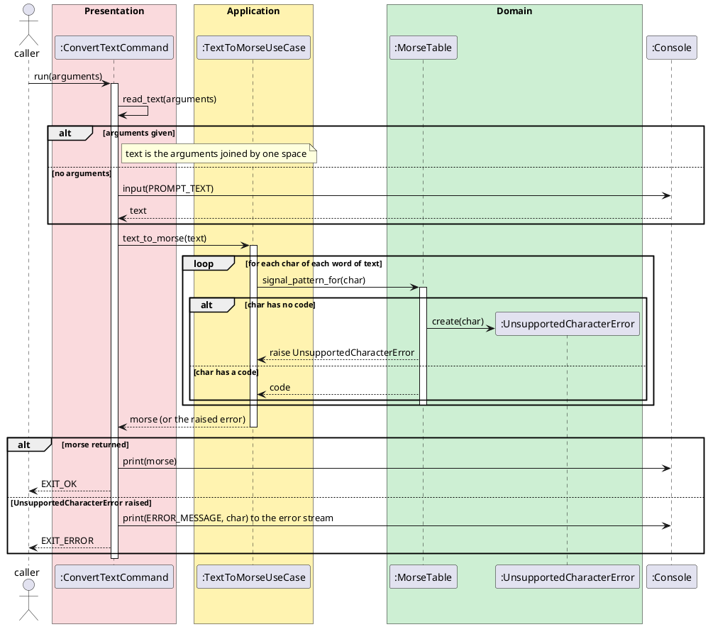

# Sequence Diagram

## Metadata
| Key | Value |
| --- | --- |
| ID | SD-001 |
| CrossReference | [OC-001], [DCD-001], [DICT-001] |

## Version History
| Date | Status | Author | Reviewer | Change | Commit |
| --- | --- | --- | --- | --- | --- |
| 2026-11-19 | Accepted | Jens Tirsvad Nielsen | S01 | Initial version Reviewed in RC-016: Go | pending |

---

## Sequence: convertTextToMorse

**Realizes:** `convertTextToMorse` in [OC-001]

This sequence answers the concerns CN-001 (a correct, tested conversion), CN-003 (run from the README) and CN-004 (the assignment's function name) of [SA-001], and serves the developers: S01, and S02 as a reader.

The system has three layers: Presentation (the command line), Application (the use case) and Domain (the Morse table and its error). It has no Infrastructure layer of its own: the standard streams of the Python runtime (`Console`) are the only outside object, and the program reads no file, no environment variable and no network.

### Diagram

### Pattern Annotations

| Pattern (GRASP / GoF) | Applied to | Rationale |
| --- | --- | --- |
| Controller (GRASP) | `ConvertTextCommand` | It receives the system operation from the Converter User and hands the work to the use case; it holds no Morse rule |
| Information Expert (GRASP) | `MorseTable` | It owns the table of Morse codes, so it is the one that knows the `code` of a `char` and that a `char` has none |
| Low Coupling (GRASP) | `TextToMorseUseCase` | It depends on the Domain only and does not know the command line, so a notebook or a test can call it directly |
| Protected Variations (GRASP) | `UnsupportedCharacterError` | A caller handles one specific error, not a dictionary lookup failure; the table can change without a change in the callers |

### Postcondition Coverage

| Postcondition (from contract) | Satisfied by message |
| --- | --- |
| A `morse` instance was created | `text_to_morse(text)` returns `morse` |
| `morse` was associated with `text` | `text_to_morse(text)`: the returned `morse` is the translation of the given `text` |
| For each `char` the `morse` was associated with its `code` | `signal_pattern_for(char)` in the loop returns the `code` |
| `morse.notation` was set in order, separated by one space and ` / ` | `text_to_morse(text)` joins the `codes` of a `word` with one space and the `words` with ` / ` |
| Exception: no `morse` created and the `char` is named | `create(char)` of `UnsupportedCharacterError` raised by `signal_pattern_for(char)`; `run` prints the message and returns `EXIT_ERROR` |

### Responsibility Check

No object receives all messages. `ConvertTextCommand` reads the text and shows the result; `TextToMorseUseCase` splits the text and joins the codes; `MorseTable` looks up one `char`; `UnsupportedCharacterError` carries the failing `char`. Each has one reason to change (the command line, the layout of the Morse code, the Morse table, the error).

---

[OC-001]: ./oc.md
[DCD-001]: ../../dcd.md
[DICT-001]: ../../dictionary.md
[SA-001]: ../../stakeholder-analysis.md
