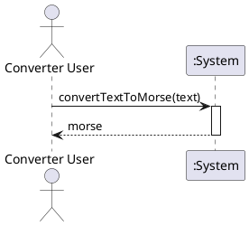

# System Sequence Diagram

## Metadata
| Key | Value |
| --- | --- |
| ID | SSD-001 |
| CrossReference | [UC-001], [DM-001], [OC-001] |
| Language | en |
| Domain | it |

## Version History
| Date | Status | Author | Reviewer | Change | Commit |
| --- | --- | --- | --- | --- | --- |
| 2026-11-19 | Accepted | Jens Tirsvad Nielsen | S01 | Initial version Reviewed in RC-014: Go | [ba98d67] |

---

## Source Use Case

Convert Text to Morse Code ([UC-001]) — scenario: main success scenario. The exception flow 2a is a failure of the same operation and is described in the Exceptions of [OC-001]; it has no diagram of its own.

## Diagram

## System Operations

| Step | Message | Parameters | Return | Use case step |
| --- | --- | --- | --- | --- |
| 1 | `convertTextToMorse` | `text` (Text) | `morse` (Morse Code) | Steps 1 to 4: the user gives the Text (1); the system checks the Characters (2), builds the Morse Code (3) and gives it back (4) |

One message covers four steps because steps 2 and 3 are internal to the system; only the Text goes in and the Morse Code comes out.

## Lifecycle Notes

The System has no state between two calls: nothing is created for the session and nothing is stored.

---

[UC-001]: ./uc.md
[DM-001]: ../../domain-model.md
[OC-001]: ./oc.md
[ba98d67]: https://git.tirsystem.com/Tirsvad-Udemy-100-days-of-code/082-assignment-text-to-morse-code-converter/commit/ba98d6725280ec49e8e215622959ea535d58843c
